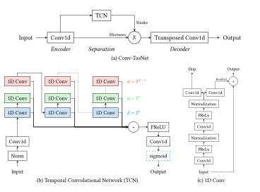

# Quantization Aware Training of Conv-TasNet speech separation model

<div align="center">
  
</div>


Conv-TasNet [[1]](#bib-1) is a fully-convolutional single-channel time-domain speech separation network. This work intend to evaluate Quantization Aware Training (QAT) possibilities on this model using HATorch [[2](#bib-2), [3](#bib-3)] quantization framework.

The project, methodology and results are detailed in the [internship report](./notes/Rapport.pdf).

# Usage

## Environnement configuration

Using [uv](https://docs.astral.sh/uv/), create a virtual environment and install dependencies
```bash
uv venv
uv sync
```

Generate LibriMix dataset: https://github.com/JorisCos/LibriMix

Config files ([conf_1.5.yml](./conf_1.5.yml), [conf_0.5.yml](./conf_0.5.yml)) `metadata_dir` should point to your LibriLix *metadata* folder

Two variants of Conv-TasNet are provided:
- 1.5: 3 seconds input, 1.53 seconds receptive field, correspond to the *best* non causal configuration from [[1]](#1)
- 0.5: 2 seconds input, 0.46 seconds receptive field, less accurate, but requires less computations

These versions hyperparameters are defined in their respective yaml configuration files

## Training Conv-TasNet model

The model can be trained from scratch in either configuration using:

```bash
python src/train.py 0.5
```

Training can be followed using Tensorboard:

```bash
tensorboard --host=127.0.0.1 --logdir=exp/ConvTasNet_0.5/lightning_logs
```

Once trained the model will be saved to `exp/ConvTasNet_0.5/compiled_model.pth`

### Evaluation
The newly trained model can be evaluated using LibriMix *test* dataset

```bash
python src/evaluate_model.py 0.5 full_precision
```

### ONNX Export
The model can be exported to ONNX

```bash
python src/export_onnx.py 0.5 full_precision
```

## Quantization Aware Training (QAT)

The trained model can be quantized using HATorch [[]]()

Multiple quantization configurations are defined (see [utils_quantize.py](./src/utils/utils_quantize.py)):
- all_S16S16
- encdec_S16S16_tcn_S8S8
- all_S8S8
- encdec_S16S16_tcn_S4S4

```bash
python src/quantize.py 0.5 all_S8S8
```

### Evaluation
After QAT, the quantized model can be evaluated

```bash
python src/evaluate_model.py 0.5 all_S8S8
```

### ONNX Export
After QAT, the quantized model can be exported to ONNX

```bash
python src/export_onnx.py 0.5 all_S8S8
```

### Separation on audio_files

Run separation on a 2-speaker .WAV 8kHz file:

```bash
python src/run_on_audio_file.py 0.5 all_S8S8 custom_audios/2-speakers-8000Hz.wav
```

# Licences

The project source code is MIT licensed. Report and figures are provided under the license CC BY-SA 4.0

HATorch ([hatorch](./hatorch/) subfolder) is based on the project and work of B. Barbe and R. Bouarah [[]](), provided under a license MIT.

---

> <a id="bib-1">[1]</a>  Y. Luo and N. Mesgarani, “Conv-TasNet: Surpassing Ideal Time-Frequency Magnitude Masking for Speech Separation,” IEEE/ACM Transactions on Audio, Speech, and Language Processing, vol. 27, no. 8, pp. 1256–1266, Aug. 2019, doi: 10.1109/TASLP.2019.2915167. https://ieeexplore.ieee.org/document/8707065
>
> <a id="bib-2">[2]</a> B. Barbe and R. Bouarah, “HATorch.” [Online]. Available: https://gitlab.inria.fr/romain-bouarah-phd/hatorch
>
> <a id="bib-3">[3]</a> B. Barbe, R. Bouarah, F. de Dinechin, and A. Volkova, "Reducing the Hardware Gap for Custom Accelerators through Quantization Aware Training, in AcMIL 2026 - 8th Workshop on Accelerated Machine Learning, Krakow (Cracovie), Poland, Jan. 2026. [Online]. Available: https://inria.hal.science/hal-05466817
>
